

  <picture>
    <source media="(prefers-color-scheme: dark)" srcset="docs/assets/banner-dark.png">
    <source media="(prefers-color-scheme: light)" srcset="docs/assets/logo.png">
    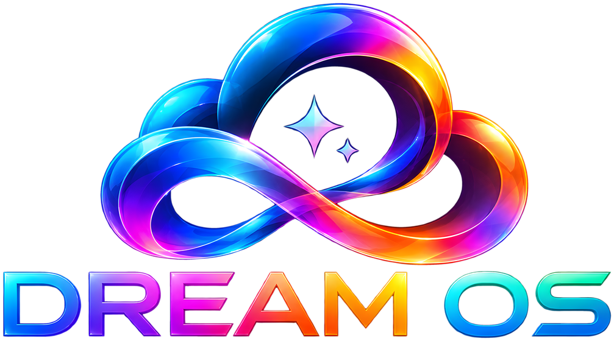
  </picture>

<b>A beautiful, cinematic home for movies and shows on the Fire TV Stick 4K Max and iPhone.</b> 
Free and open source. You bring your own accounts; Dream brings the experience.

  
  
  
  

  <a href="#get-dream"><b>Install</b></a>&nbsp;&nbsp;·&nbsp;&nbsp;
  <a href="#features"><b>Features</b></a>&nbsp;&nbsp;·&nbsp;&nbsp;
  <a href="BUILDING.md"><b>Building</b></a>&nbsp;&nbsp;·&nbsp;&nbsp;
  <a href="CONTRIBUTING.md"><b>Contributing</b></a>&nbsp;&nbsp;·&nbsp;&nbsp;
  <a href="DISCLAIMER.md"><b>Disclaimers</b></a>

  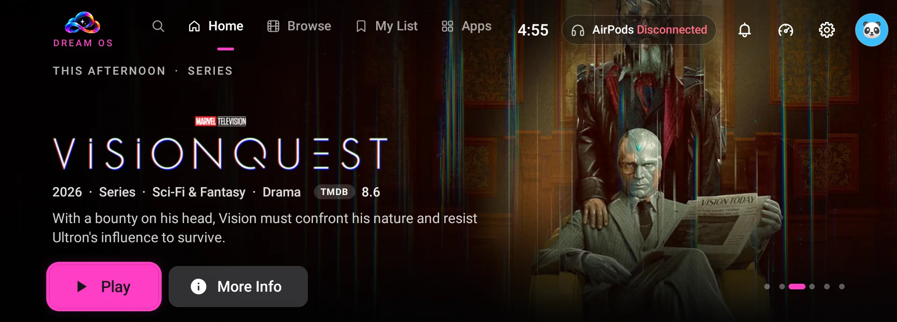 
  Cinematic Home Hero With Live Ratings

 

## What Is Dream OS?

Dream OS turns your Fire TV Stick into a calm, cinematic place to find and watch movies and shows, and brings
the same experience to your iPhone. It browses like a premium streaming service: big artwork, trailers that play
in the background, smart rows, and one Play button that just works.

Dream doesn't host or include any content. It connects the services **you** already use (a free TMDB key for
artwork and details, your own debrid account, and the scraper repositories you choose to add) and puts them
behind one clean, fast interface.

 

## Platforms

| Platform | Status | How to Install |
| :-- | :-- | :-- |
| **Fire Stick** (4K Max, 1st gen) | Available | [Fire Stick Install Guide](INSTALL-FIRESTICK.md) |
| **iPhone** | Available (sideloaded) | [iPhone Install Guide](INSTALL-IOS.md) |
| **Windows** | Coming Soon | |
| **Mac** | Coming Soon | |
| **Linux** | Coming Soon | |

**Tested On:** Fire Stick: a Fire TV Stick 4K Max (1st generation, 2021) on Fire OS 7.7.1.3; other Fire TV models
are untested. iPhone: tested on iOS 27.2; requires iOS 17 or later. Older iPhones may load more slowly, and HDR
needs an HDR-capable screen. Reports from other devices are welcome in
[Issues](https://github.com/DenseCow/dream-os/issues).

 

## Get Dream

### Fire Stick

  
  &nbsp;
  

The easy way is the free **Downloader** app on your Fire Stick. Open it, choose the address box, and type:

<table>
  <tr>
    <td align="center">
      DOWNLOADER CODE 
      <h2><!--dl-code-->Coming Soon<!--/dl-code--></h2>
    </td>
  </tr>
</table>

Or type this address instead: `github.com/DenseCow/dream-os/releases/latest/download/DreamOS.apk`

The [Fire Stick Install Guide](INSTALL-FIRESTICK.md) walks through every step, including allowing Downloader to
install apps and the optional steps that make Dream your Home screen.

### iPhone

  
  &nbsp;
  

Dream for iPhone isn't on the App Store. You install it yourself with a free sideloading app such as SideStore
or AltStore, using your own Apple Account; no Mac needed. The [iPhone Install Guide](INSTALL-IOS.md) explains
how, and how to build it from source.

 

## Screenshots

### Fire Stick

<table>
  <tr>
    <td width="50%" align="center">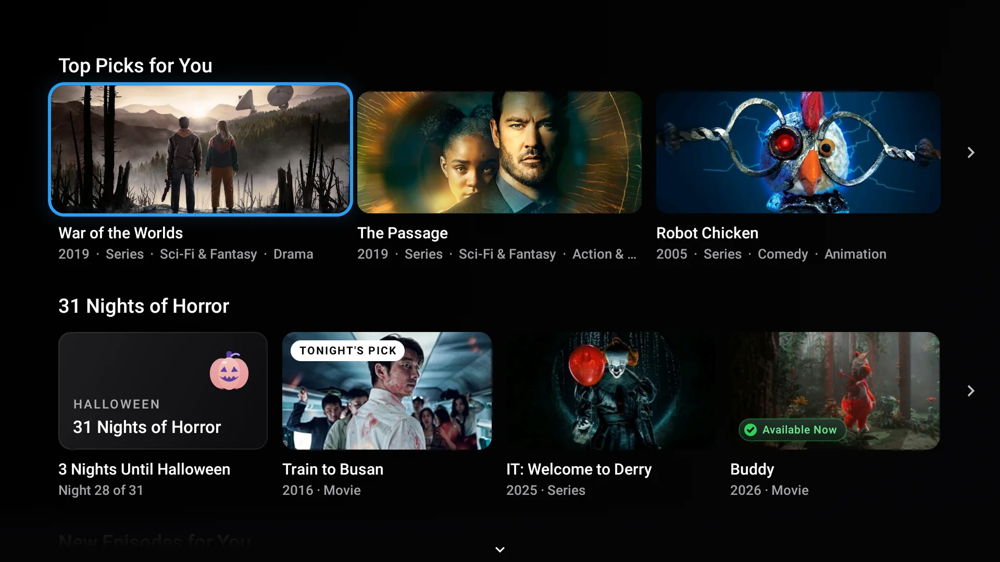 Top Picks and Seasonal Rows</td>
    <td width="50%" align="center">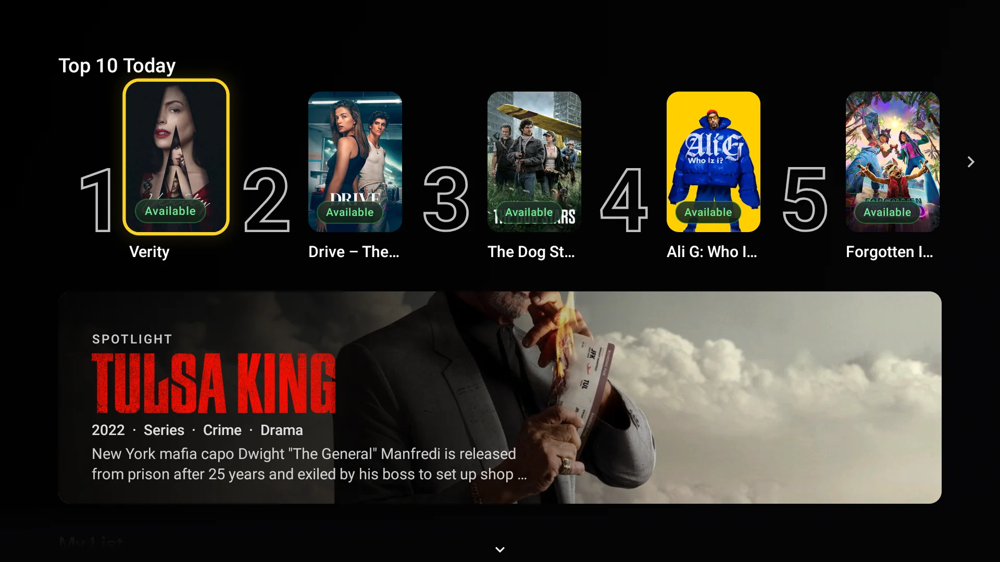 Top 10 Today With Ranked Numerals</td>
  </tr>
  <tr>
    <td width="50%" align="center">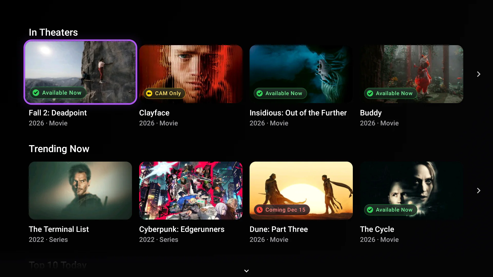 Availability at a Glance</td>
    <td width="50%" align="center">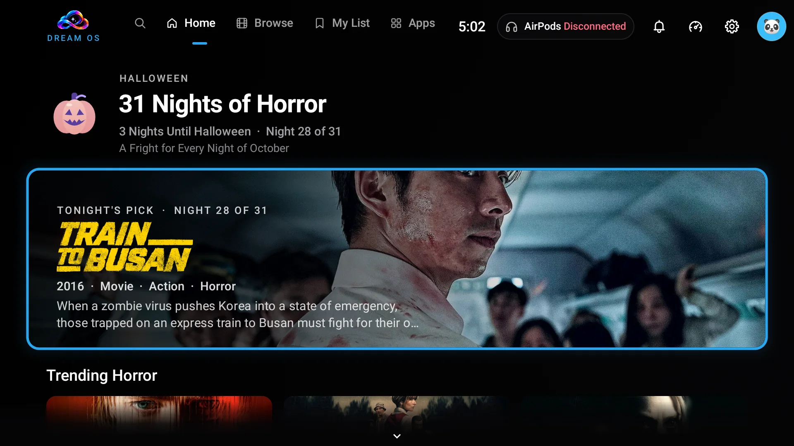 Seasonal Hubs: 31 Nights of Horror</td>
  </tr>
  <tr>
    <td width="50%" align="center">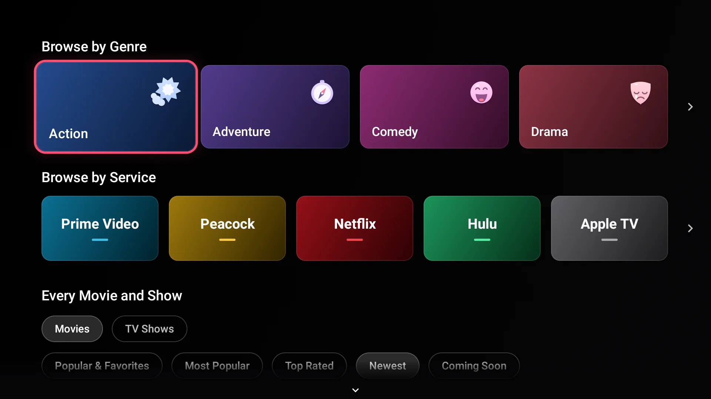 Browse by Genre, Service or Catalog</td>
    <td width="50%" align="center">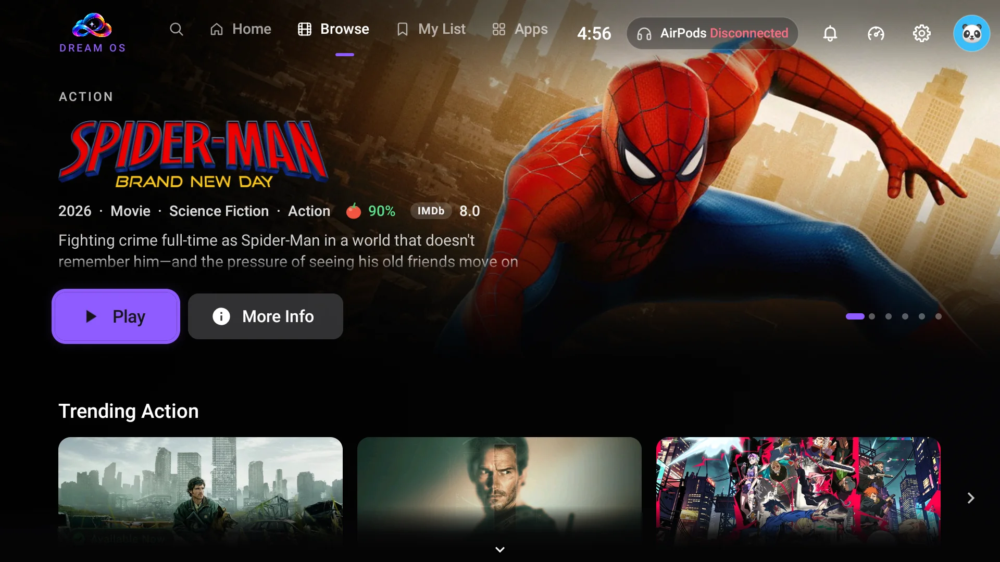 Genre Pages With Their Own Hero</td>
  </tr>
  <tr>
    <td width="50%" align="center">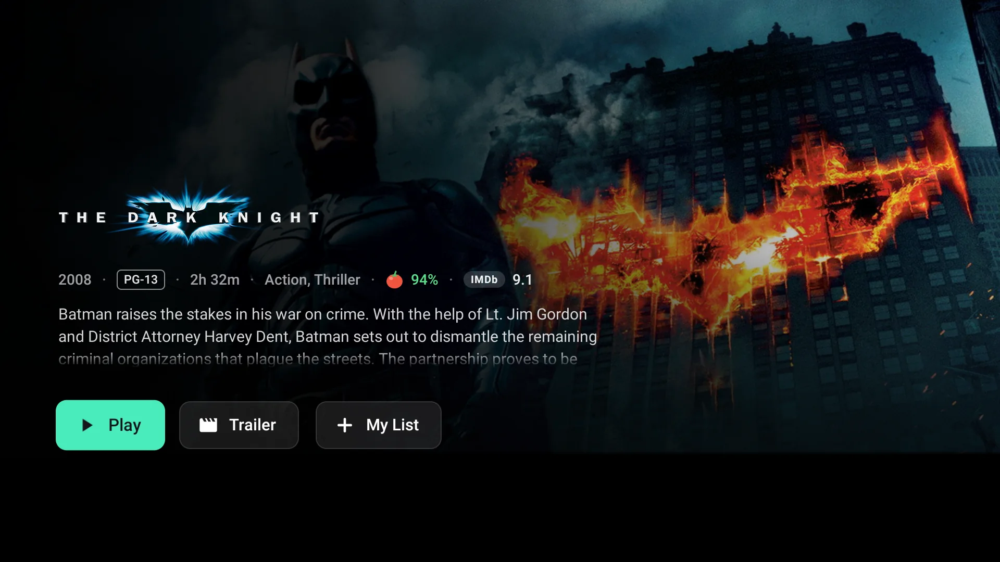 Title Pages With IMDb and Rotten Tomatoes Scores</td>
    <td width="50%" align="center">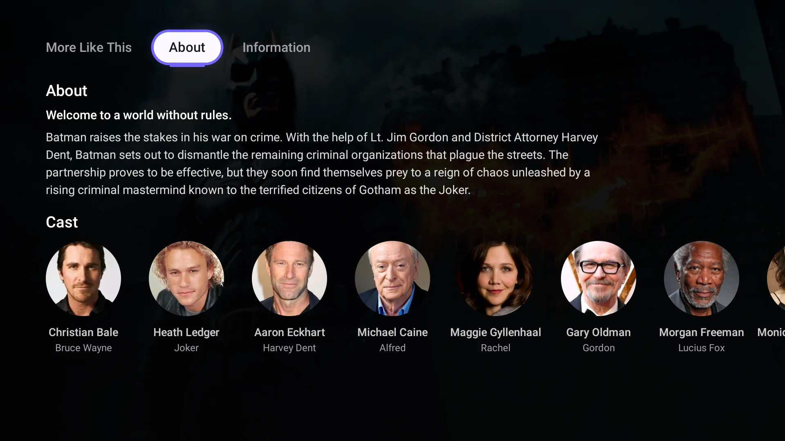 About and Cast</td>
  </tr>
  <tr>
    <td width="50%" align="center">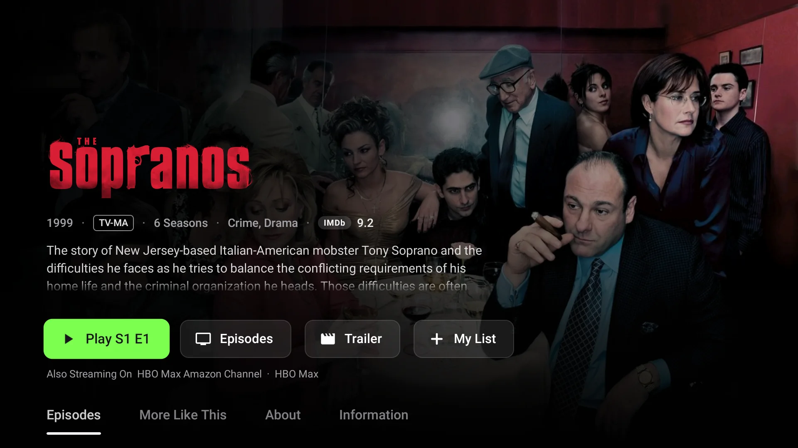 TV Show Pages That Pick Up Where You Left Off</td>
    <td width="50%" align="center">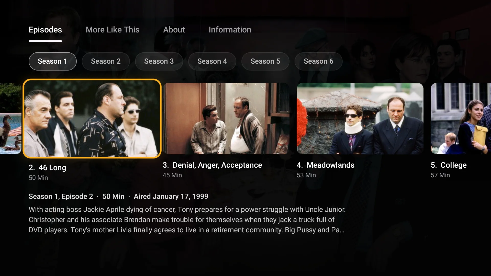 Season and Episode Rail</td>
  </tr>
  <tr>
    <td width="50%" align="center">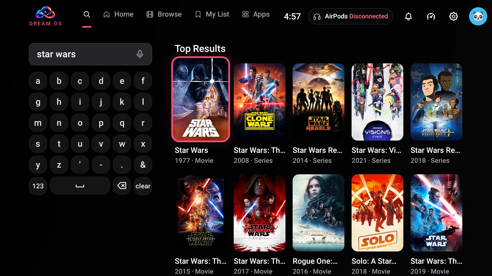 Search With Instant Results</td>
    <td width="50%" align="center">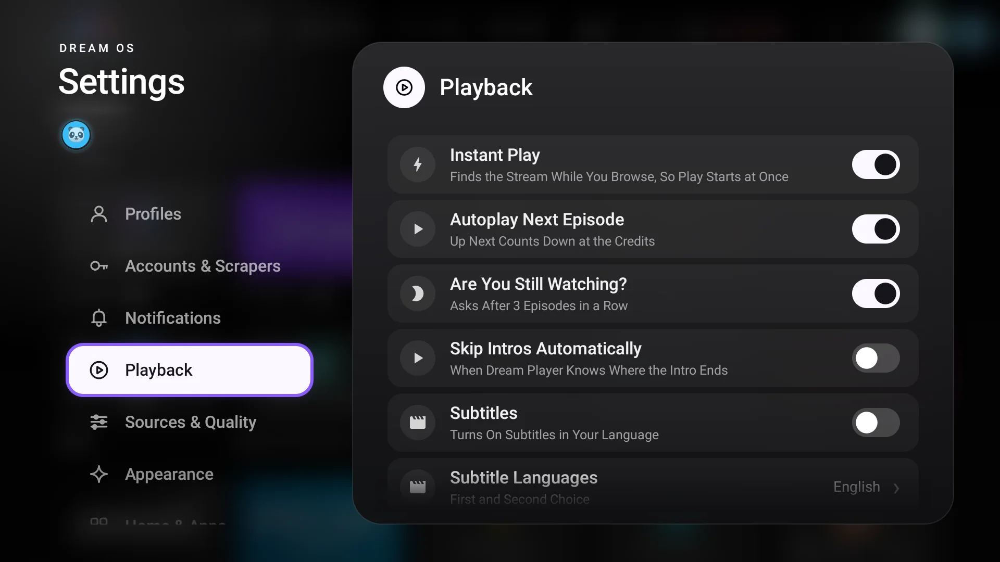 Clean, Simple Settings</td>
  </tr>
</table>

Real screenshots from a Fire TV Stick 4K Max. Posters, artwork and descriptions come from TMDB. The colored
service tiles are Dream's own designs, not official logos. iPhone screenshots are coming soon.

 

## Features

### A Home Built for the Big Screen
A black, glassy Dream Cinema look with a soft rainbow glow. Trailers play behind the title you're on, and rows
like Continue Watching, Top 10 Today, In Theaters, New Episodes and Because You Watched keep the good stuff close.
Seasonal hubs gather holiday favorites when it's their time of year.

### One Play Button
Dream Core finds the best copy for you from your own debrid accounts and the scraper repositories you add, in the
quality you prefer, and starts it in seconds. Instant Play gets the next episode ready before you need it.

### Dream Player
A clean player with subtitles, audio languages, Skip Intro and Skip Credits, an X-Ray style cast and info panel,
Up Next with autoplay, and Start Over. On iPhone it also does Picture in Picture.

### Your Library, Everywhere
My List, Continue Watching and a Watched mark on everything you've finished. Banners let you know when a new
episode of a show you follow is out. Connect Trakt (optional) to keep your history in sync.

### Profiles for Everyone
Separate profiles with their own lists and history, optional PINs, and Kids profiles with age limits. Anime
lives on its own page instead of filling every row.

### Scores and Details at a Glance
IMDb and Rotten Tomatoes scores (with a free OMDb key), cast pages, season guides, air times, and where a title
is streaming on the services you already pay for.

### Made for the Fire Stick
Optionally replace Amazon's home screen, search with the voice remote, type from your phone with Phone Remote,
see at a glance whether your AirPods are connected, rest on the Dream screensaver, and get updates right inside the app.

### Made for iPhone
A touch-first take on the same experience: portrait browsing, a landscape player, background audio, and the
same accounts, profiles and library rules as the TV.

 

## How It Works

1. **You add a free TMDB key.** Dream uses TMDB for posters, details, search and rows. Setup shows you how to
   get one in a couple of minutes.
2. **You link your own debrid account.** Real-Debrid, AllDebrid, Premiumize or TorBox, signed in with a code on
   screen. Dream works with whichever ones you link, in your order.
3. **You add scraper repositories.** Dream runs the scraper modules you choose to add, inside the app, to find
   links for what you want to watch. Dream ships with none.
4. **You press Play.** Dream picks the best match for your quality settings and plays it in Dream Player.

Your keys, accounts, profiles and history stay on your device. Dream has no servers of its own and sends
nothing to the developer. More in [Privacy](#privacy).

 

## Privacy

- **No accounts, no tracking, no analytics.** Dream has no servers and collects nothing.
- **Your keys stay on your device.** TMDB, OMDb, debrid and Trakt sign-ins are stored only on the device you
  entered them on (in the iPhone's Keychain on iOS).
- **Dream talks straight to the services you use:** TMDB, OMDb, Trakt, your debrid services and your scraper
  repositories, plus a few free public services for extras: TVmaze (air times), TheIntroDB, AniSkip, ARM and
  Kitsu (skip markers), OpenSubtitles (subtitles), the video host TMDB lists for trailers, Cloudflare (only when
  you run the speed test), and on the Fire Stick Open-Meteo for the weather (with an approximate location from your
  internet address via ipwho.is or GeoJS) and GitHub to check for Dream updates.

 

## Open Source

Dream OS is free software, released under the [GNU General Public License v3.0](LICENSE). You can use it, study
it, change it and share it under the same terms. It builds on great open-source projects; see
[Third-Party Notices](THIRD_PARTY_NOTICES.md) for their licenses.

| Folder | What's Inside |
| :-- | :-- |
| [`firestick/`](firestick) | The Fire Stick app (Kotlin, Android 7.1+ / Fire OS 6+) |
| [`ios/`](ios) | The iPhone app (Swift and SwiftUI, iOS 17+) |
| [`docs/`](docs) | Brand images and screenshots |
| [`tools/`](tools) | Publishing and release scripts |

Want to help? Start with [Contributing](CONTRIBUTING.md) and [Building](BUILDING.md). Found a security problem?
See [Security](SECURITY.md).

 

## Credits

- This product uses the TMDB API but is not endorsed or certified by TMDB.
- Streaming availability data provided by JustWatch (through TMDB).
- Ratings data from the OMDb API. Air times from TVmaze. Skip markers from TheIntroDB and AniSkip.

### Built With Claude
Dream OS was designed and built with the help of Claude, Anthropic's AI assistant, through
[Claude Code](https://claude.com/claude-code). Every change was reviewed and tested by the maintainer on real
devices. This doesn't mean Anthropic endorses or sponsors the project.

 

## Disclaimers

Dream OS is an independent open-source project. It hosts, stores and distributes no movies, shows or streams,
and includes no sources. You bring your own TMDB key, debrid accounts and scraper repositories, and you are
responsible for following the law and the terms of the services you use where you live. Dream isn't affiliated
with, endorsed by, or sponsored by Amazon, Apple, TMDB, any streaming service, any debrid service, Anthropic or
anyone else it mentions. It is provided as is, with no warranty. Please read the full [Disclaimers](DISCLAIMER.md).

 

   
  Dream OS · Free and open source under GPL-3.0

